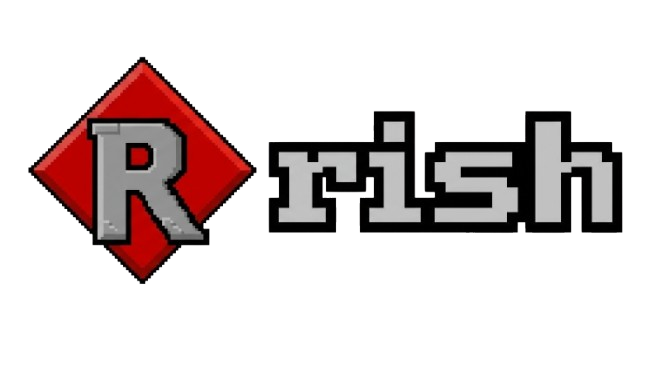

---

**rish** — лёгкая интерактивная командная оболочка для Unix-систем, написанная на C++20.

Название расшифровывается как **R**untime **I**nteractive **Sh**ell — интерактивная оболочка времени выполнения.

---

## Возможности

- **Динамический промпт** — имя пользователя, хост, текущий путь с автоматической заменой домашней директории на `~`
- **Цветной вывод** — ANSI-подсветка промпта
- **История команд** — сохраняется между сессиями в `~/.rish_history`
- **Fish-style подсказки** — при вводе показывается тускло-красный «призрак» похожей команды из истории
- **Tab-принятие подсказки** — одна клавиша, чтобы согласиться
- **Навигация по истории** — стрелка вверх
- **Сырой ввод** — посимвольная обработка без ожидания Enter
- **Встроенные команды** — `exit`, `cd` (включая `cd ~`)
- **Минимальные зависимости** — только стандартная библиотека C++ и POSIX

---

## Требования

- Компилятор с поддержкой **C++20** (GCC 10+, Clang 10+)
- **Linux** или другая Unix-подобная система (используются `unistd.h`, `termios.h`)

---

## Сборка

```bash
g++ -std=c++20 -Wall -Wextra -O2 -s rish.cpp -o rish
```

---

## Горячие клавиши

| Клавиша | Действие |
| ----------- | ----------- |
| Tab | Принять подсказку из истории |
| ↑ | Предыдущая команда из истории (ВНИМАНИЕ! МОЖЕТ НЕ РАБОТАТЬ) |
| Backspace | Удалить символ |
| Enter | Выполнить команду |